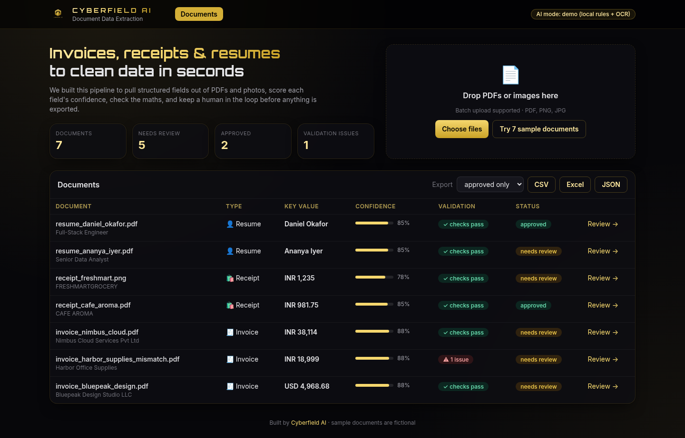
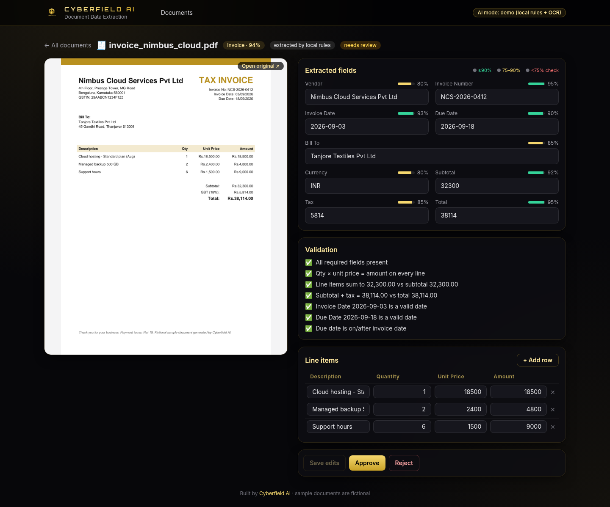
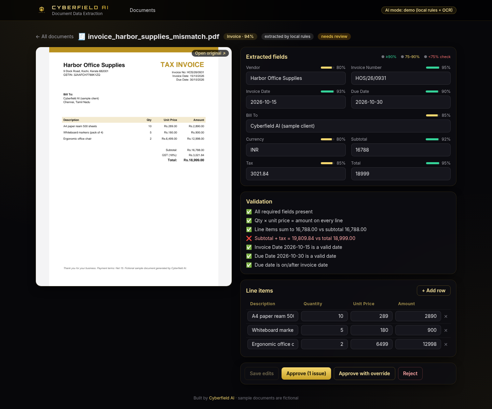
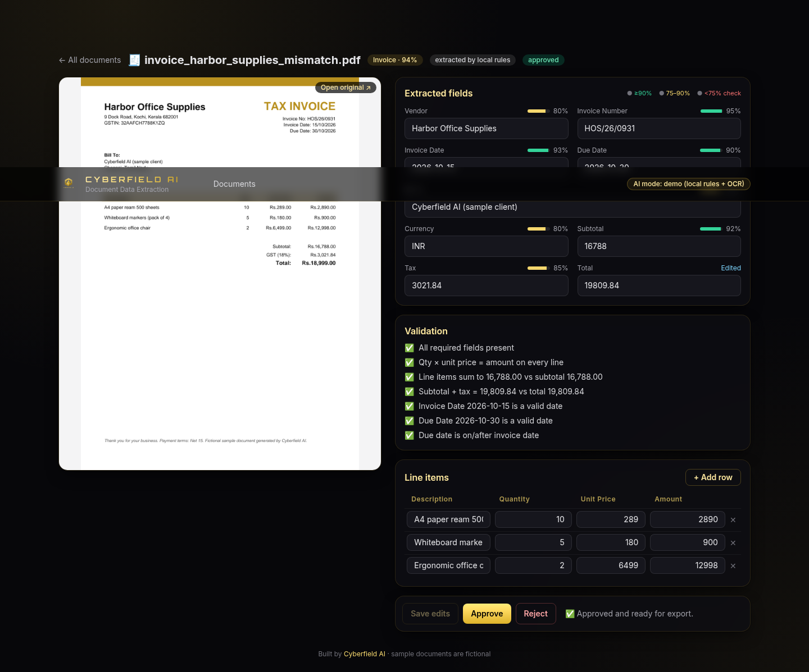
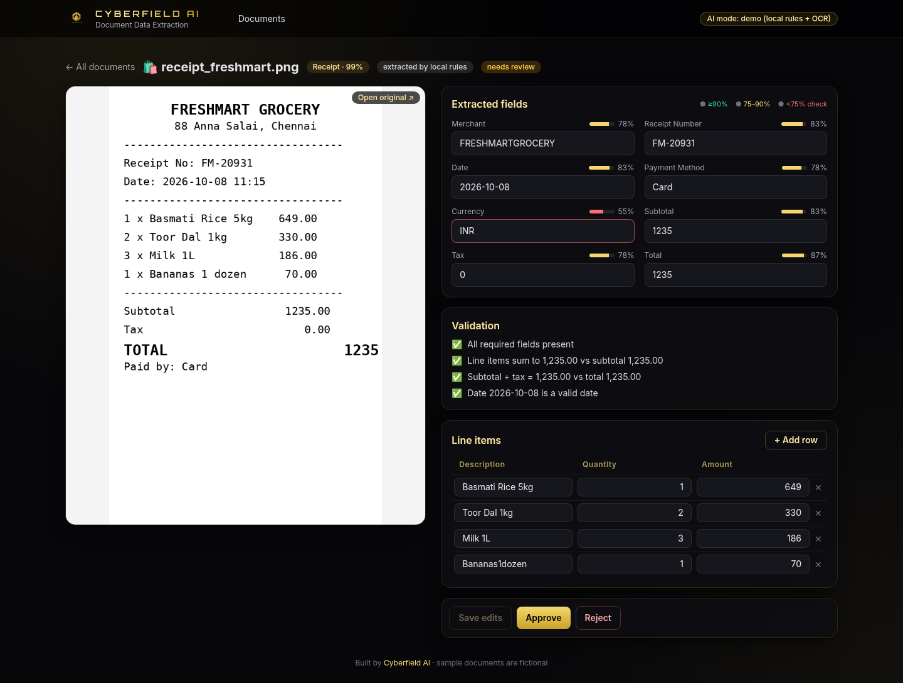
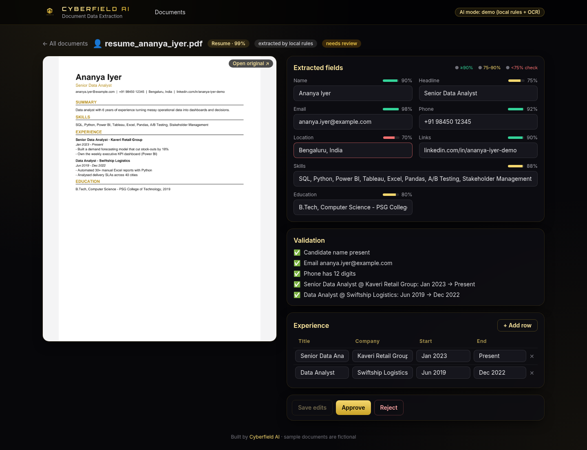
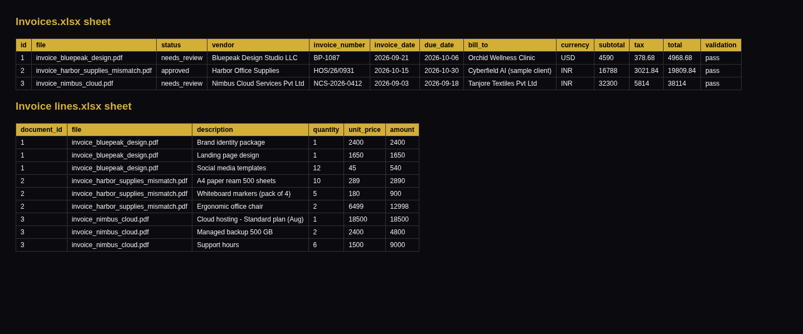

<p align="center"></p>
<h1 align="center">Cyberfield AI · Document Data Extraction</h1>
<p align="center"><b>Turn invoices, receipts and resumes (PDF or photo) into clean, validated data, with a human approving every record before it's exported.</b><br/>
Runs locally with zero API keys. Switch on an LLM with one environment variable.</p>

---

We're **Cyberfield AI**, a three-person AI agency. Teams spend hours typing invoice totals and CV details into spreadsheets, so we built this pipeline to do that work for them: it extracts the fields, tells you how sure it is about each one, checks the maths, and exports to Excel, CSV or JSON once a person signs off.



## What it does

| | |
|---|---|
| 📥 **Batch upload** | Drag in many PDFs and images at once, or click **Try 7 sample documents** |
| 🧠 **Auto-classify** | Sorts each file as an invoice, receipt or resume, with a confidence score |
| 🧾 **Invoices** | Vendor, invoice number, invoice and due dates, bill-to, currency, line items (description, qty, unit price, amount), subtotal, tax, total |
| 🛍️ **Receipts** | Merchant, receipt number, date, payment method, items, subtotal, tax, total |
| 👤 **Resumes** | Name, headline, email, phone, location, links, skills, education, and work experience (title, company, start, end) |
| 🎯 **Per-field confidence** | Colour-coded bars. Anything under 75% is outlined for review |
| ✅ **Validation** | Line items add up to the subtotal, subtotal + tax = total, qty × price = amount, dates are real and plausible, due date falls after issue date, email and phone formats, experience date ranges |
| 👀 **Human review** | Side-by-side preview and editable fields and rows. Edits re-run validation. Approval is blocked while errors remain (with an explicit override) |
| 📤 **Export** | CSV (one row per document), Excel (a sheet per document type plus line-item and experience sheets), and full JSON with confidence and validation results |

### Review screen


### Validation catches a wrong total
The sample `invoice_harbor_supplies_mismatch.pdf` has a total that doesn't match subtotal + GST. The app flags it and won't approve it until the total is corrected or a reviewer deliberately overrides.

| Flagged | Fixed and approved |
|---|---|
|  |  |

| Photo receipt (local OCR) | Resume |
|---|---|
|  |  |

### Excel export


## Demo mode vs LLM mode

| | Demo mode (default, no keys) | LLM mode (`LLM_API_KEY` set) |
|---|---|---|
| PDFs | `pdfplumber` text, then regex and layout rules | Text sent to the LLM with a strict JSON schema |
| Images | Local OCR with [RapidOCR](https://github.com/RapidAI/RapidOCR) (ONNX, no internet), then rules | Image sent to a vision model |
| Confidence | Rule-based (label-anchored match beats a heuristic; OCR lowers confidence) | Model-reported |
| Fallback | – | If the LLM call fails, the app falls back to demo-mode rules |

The demo rules are tuned for the bundled samples and documents laid out the same way. For messy real-world layouts, LLM mode is the right choice.

## Run it on Windows

You need **Python 3.10+** and **Node.js 18+** installed.

1. Download or clone this repo.
2. Double-click **`run.bat`**. On first run it creates `.venv`, installs dependencies and builds the UI.
3. Open **http://127.0.0.1:8000** and click **Try 7 sample documents**.

Manual steps in PowerShell:

```powershell
python -m venv .venv
.venv\Scripts\activate
pip install -r requirements.txt
cd frontend; npm install; npm run build; cd ..
cd backend; python -m uvicorn app.main:app --port 8000
```

To use an LLM, run `set LLM_API_KEY=sk-...` (cmd) or `$env:LLM_API_KEY="sk-..."` (PowerShell) before starting the server. Optionally set `LLM_BASE_URL` and `LLM_MODEL` to use any OpenAI-compatible provider. See `.env.example`.

Uploaded files and the SQLite database live in `data/`. Delete that folder to start fresh.

## API at a glance

`POST /api/documents` (multipart `files`, batch) · `POST /api/samples/load` · `GET /api/documents` · `GET/PUT /api/documents/{id}` · `POST /api/documents/{id}/approve?force=` · `POST /api/documents/{id}/reject` · `GET /api/export?format=csv|xlsx|json&status=approved|all`. Interactive docs are at `/docs`.

## Tests

```powershell
python -m playwright install chromium   # first time only
python -m pytest -v                     # or run_tests.bat
```

- `tests/test_extraction.py`: field extraction on every sample (including OCR on the PNG), validation rules, the batch upload → edit → approve → CSV/Excel/JSON export flow, and rejection of unsupported files.
- `tests/test_smoke_playwright.py`: in a real browser, loads the samples, fixes the bad invoice, approves it and downloads the CSV.
- `python scripts/make_samples.py` regenerates the fictional sample documents. `python scripts/screenshots.py` regenerates the screenshots.

## Project layout

```
backend/app/   main.py (API) · text.py (PDF text + OCR) · rules.py (demo extractor) · llm.py · validate.py · exporter.py · db.py (SQLite)
frontend/src/  Vite + React + TypeScript + Tailwind: upload/batch table and review screen
samples/       7 fictional documents (3 invoices, 2 receipts incl. a PNG photo, 2 resumes)
```

## Where we'd take it next for a client

Custom document types such as purchase orders, bank statements and KYC forms. Multi-page table extraction. Duplicate-invoice detection. Push to accounting tools (Tally, Zoho Books, QuickBooks, Xero) or an ATS. Reviewer accounts and an audit log.

---
**Cyberfield AI.** We build practical AI automations for small businesses. Want this for your documents? Get in touch through our Upwork or Fiverr profile.
